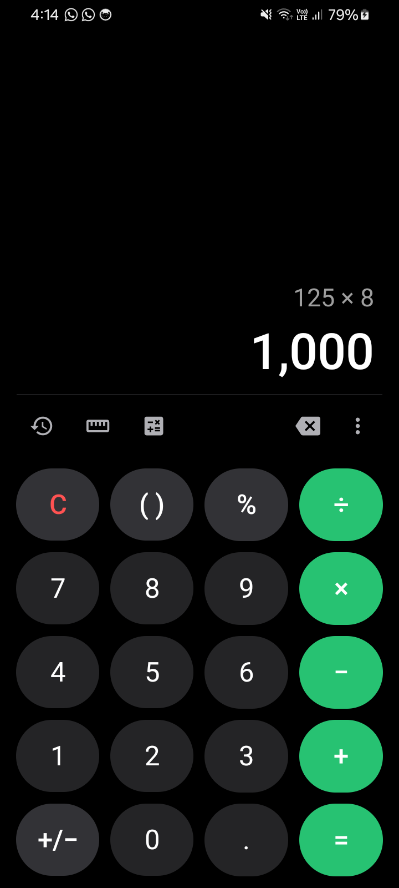
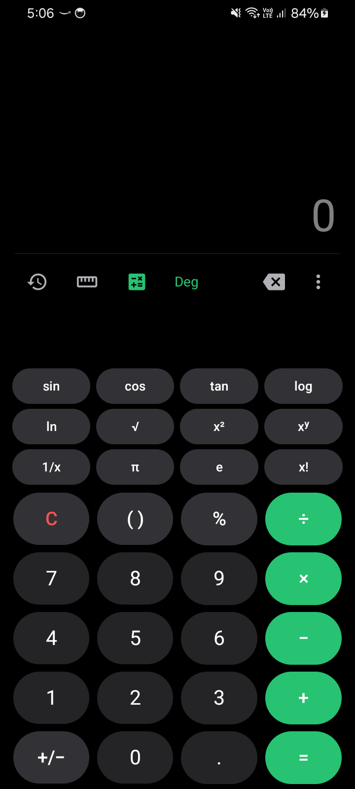
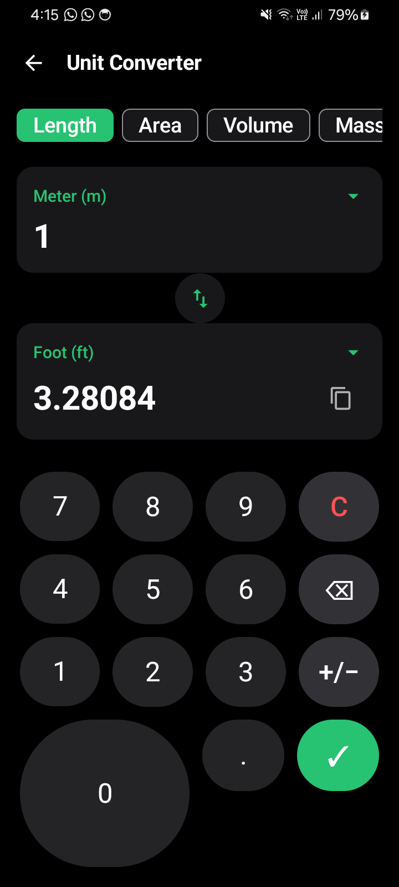
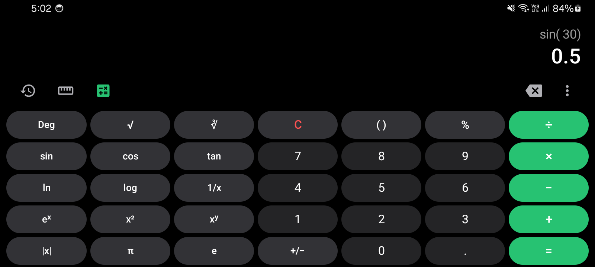

# Calculator — StrangeInfinity

[](https://github.com/dev-hints/Calculator/releases/latest/download/app-release-signed.apk)

[-3DDC84.svg?style=flat&logo=android)](https://developer.android.com)
[-34A853.svg?style=flat)](https://developer.android.com)
[](https://kotlinlang.org)
[](https://developer.android.com/jetpack/compose)
[](https://developer.android.com/training/data-storage/room)
[-00C853.svg?style=flat)](https://github.com/dev-hints/Calculator)

A precision-crafted native Android calculator application developed under the **StrangeInfinity** brand, inspired by the design language and interaction patterns of Samsung Calculator. Built with **Kotlin**, **Jetpack Compose**, **Material 3**, and a custom **high-precision mathematical engine**.

---

## Screenshots

| Standard Calculator | Scientific Mode | Unit Converter | Landscape Mode |
| :---: | :---: | :---: | :---: |
|  |  |  |  |

---

## Features

### 1. Mathematical Correctness and Precision Engine
- **High-Precision Decimal Arithmetic**: Powered by `BigDecimal` with `MathContext.DECIMAL128` (34 decimal digits of precision). Eliminates binary floating-point artifacts such that `0.1 + 0.2 = 0.3`.
- **Percentage Rules**:
  - Additive: `100 + 25% = 125`
  - Subtractive: `200 - 10% = 180`
  - Multiplicative: `50 × 20% = 10`
  - Divisive: `50 ÷ 25% = 200`
  - Standalone: `25% = 0.25`
- **Real-Time Live Preview**: Calculates intermediate results dynamically as you type.
- **Continuous Chaining**: Tapping an operator after `=` automatically continues from the previous calculation result.

### 2. Scientific Calculator
- **Toolbar Toggle**: Expandable scientific keypad accessible directly from the main toolbar.
- **Functions Supported**:
  - Trigonometric: `sin`, `cos`, `tan`, `asin`, `acos`, `atan`, `sinh`, `cosh`, `tanh`.
  - Angle Modes: Switchable `Deg` (Degrees) and `Rad` (Radians) with instant recalculation.
  - Exponents and Roots: `x²`, `x³`, `xʸ`, `√`, `∛`, `10ˣ`, `eˣ`.
  - Logarithms: Natural log (`ln`), common log (`log` / `log10`).
  - Core Math: Reciprocal (`1/x`), absolute value (`|x|`), and factorial (`x!`) with overflow protection up to n = 1000.
  - Constants: Pi (π) and Euler's number (e).
- **Domain Guardrails**: Handles negative roots, logarithm domain boundaries, tangent singularities, and division by zero with clean inline alerts.

### 3. Persistent Calculation History
- **Room SQLite Persistence**: Saves expressions, formatted results, and timestamps across application restarts.
- **Interactive History Sheet**: Tap any entry to reuse the expression or result.
- **Entry Management**: Delete individual entries or clear all history with confirmation.

### 4. Offline Unit Converter
- **100% Offline Execution**: Completely self-contained conversion suite with zero network requirements.
- **Categories (8 Supported)**:
  - Length: Meter, Kilometer, Centimeter, Millimeter, Micrometer, Nanometer, Mile, Yard, Foot, Inch, Nautical Mile.
  - Area: Square Meter, Square Kilometer, Hectare, Acre, Square Mile, Square Yard, Square Foot, Square Inch.
  - Volume: Liter, Milliliter, Cubic Meter, Gallon (US), Quart, Pint, Cup, Fluid Ounce.
  - Mass: Kilogram, Gram, Milligram, Metric Ton, Pound, Ounce, Carat.
  - Temperature: Celsius (°C), Fahrenheit (°F), Kelvin (K) with exact offset conversions.
  - Speed: m/s, km/h, mph, knot, ft/s.
  - Time: Second, Millisecond, Minute, Hour, Day, Week, Year.
  - Data Storage: Byte, Kilobyte (1024 B), Megabyte (1024 KB), Gigabyte (1024 MB), Terabyte, Petabyte.
- **Controls**: Dedicated numeric keypad, bidirectional unit swap, and one-tap clipboard copy.

### 5. Security and Privacy
- **Zero Network Permissions**: `android.permission.INTERNET` is not requested. The operating system physically blocks all network activity.
- **Safe Parsing**: Custom Recursive Descent Parser evaluates math safely without `eval()`, JavaScript engines, or dynamic code execution.
- **Sandbox Storage**: Calculation records stay strictly inside the private application sandbox.
- **Sanitized Clipboard**: Pasted strings are filtered through a strict whitelist.
- **Zero Telemetry**: No analytics SDKs, advertising trackers, or background listeners.

---

## Architecture

The codebase follows Clean Android Architecture with strict separation between Presentation, Domain, and Data layers:

```
app/src/main/java/store/strangeinfinity/calculator/
├── domain/
│   ├── calculator/
│   │   ├── ExpressionEvaluator.kt   # Recursive Descent Parser and Math Engine
│   │   ├── NumberFormatter.kt       # Decimal128 and thousand separators
│   │   └── CalculationResult.kt     # Sealed class for Success and Error states
│   └── converter/
│       └── UnitConverter.kt         # Conversion algorithms and unit definitions
├── data/
│   ├── history/
│   │   ├── CalculationEntity.kt     # Room database entity
│   │   ├── CalculationDao.kt        # SQLite Data Access Object
│   │   ├── CalculatorDatabase.kt    # Room database instance
│   │   └── HistoryRepository.kt     # Flow-based repository
│   └── settings/
│       └── SettingsManager.kt       # Theme and angle unit preferences
├── ui/
│   ├── components/
│   │   ├── CalculatorButton.kt      # Rounded keys with haptic feedback
│   │   ├── CalculatorDisplay.kt     # Auto-scaling expression and result area
│   │   ├── KeypadStandard.kt        # 4x5 standard arithmetic grid
│   │   ├── KeypadScientific.kt      # Expandable scientific panel
│   │   ├── ToolbarHandle.kt         # Middle tool row and options menu
│   │   ├── HistorySheet.kt          # Modal bottom sheet for history
│   │   ├── UnitConverterScreen.kt   # Dedicated converter screen and keypad
│   │   └── AboutDialog.kt           # StrangeInfinity branding dialog
│   ├── theme/
│   │   ├── Color.kt                 # Palette (AMOLED Dark and Clean Light)
│   │   ├── Type.kt                  # Typography hierarchy
│   │   └── Theme.kt                 # Material 3 and custom palette composition
│   ├── CalculatorScreen.kt          # Root responsive screen
│   ├── CalculatorViewModel.kt       # UI state management and event coordination
│   └── ConverterViewModel.kt        # Unit converter state management
└── MainActivity.kt                  # Edge-to-edge container and hardware key handling
```

---

## Building and Running

### Prerequisites
- JDK: Java 17 or Java 21
- Android SDK: Build Tools `34.0.0`, Platform `android-34`
- Gradle: 8.10 (Gradle wrapper included)

### Build Commands

```bash
# Run automated unit test suite (17/17 tests)
./gradlew test

# Build debug APK
./gradlew assembleDebug

# Build release APK with Lint-Vital checks
./gradlew assembleRelease
```

### Installation via ADB

```bash
# Install to connected Android device
adb install -r app-release-signed.apk

# Launch Calculator
adb shell am start -n store.strangeinfinity.calculator/.MainActivity
```

---

## Automated Testing

Run the automated test suite with:

```bash
./gradlew testDebugUnitTest
```

Verified test coverage includes:
- Basic operations (`+`, `−`, `×`, `÷`) and operator precedence
- Floating-point precision validation (`0.1 + 0.2 = 0.3`)
- Percentage rules across addition, subtraction, multiplication, and division
- Trigonometric functions in Degree and Radian modes
- Logarithms, powers, roots, factorials, and division-by-zero protection
- Unit converter formulas across all 8 supported measurement categories

---

## License and Attribution

Developed and published under the **StrangeInfinity** brand.  
Copyright © 2026 StrangeInfinity. All rights reserved.
